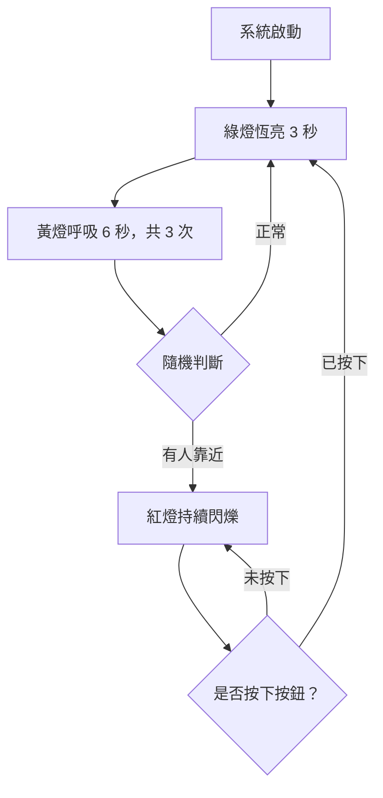

# STM32 LED 個人隱私預警系統

**STM32 LED Privacy Alert System**

使用 STM32 NUCLEO-G474RE 開發板，透過三顆 LED 與一顆按鈕，模擬家人在家中的活動情境，實現個人隱私預警系統的概念。

本專題不安裝真實感測器，而是利用 LED 燈號、時間控制、隨機判斷與按鈕互動，呈現完整的預警流程。

---

<details>
<summary><strong>1. 情境故事與製作動機</strong></summary>

### 情境故事

在日常生活中，每個人都需要屬於自己的個人隱私空間。

當我待在自己的房間休息、讀書或做其他事情時，有時候不希望家人突然開門進來打擾，因此希望能提前知道是否有人正朝房間靠近，讓自己有時間做好準備。

假設家人正在客廳看電視、看書，或各自在自己的房間活動，代表目前沒有需要特別注意的情況，此時系統顯示綠燈。

當有人起身去上廁所、洗碗或在家中走動時，雖然不一定會靠近我的房間，但仍需要稍微提高警覺，因此系統改以黃燈呼吸提醒。

如果有人明顯朝我的房間走來，系統便進入紅燈預警狀態，持續閃爍提醒我做好準備。

當我已經準備好後，可以按下確認按鈕，讓系統解除預警並重新開始運作。

### 製作動機

本專題的發想來自於我對個人隱私空間的重視，希望將生活中的實際需求與微算機課程所學的技術結合。

透過 STM32 開發板控制紅、黃、綠三種 LED，設計出具有正常、警戒及預警三種狀態的互動系統。

本次專題主要目的是展示系統控制與互動的概念，因此不使用真正的人體或動作感測器，而是透過程式模擬家人的活動情境。

</details>

<details>
<summary><strong>2. 替身對照與情境模擬</strong></summary>

### 替身對照表

| 實際生活情境 | 模擬元件 | 顯示效果 |
|---|---|---|
| 家人在客廳或自己的房間活動 | 🟢 綠色 LED | 恆亮 3 秒 |
| 有家人起身走動 | 🟡 黃色 LED | 6 秒內呼吸 3 次 |
| 有人朝我的房間走來 | 🔴 紅色 LED | 持續閃爍 |
| 使用者已經做好準備 | 🔘 確認按鈕 | 按下後回到綠燈 |

### 各狀態說明

**正常狀態（綠燈）**

家人正在客廳看電視、讀書或各自在房間活動，沒有靠近我的房間，因此綠燈恆亮 3 秒。

**警戒狀態（黃燈）**

有人開始在家中走動，例如上廁所或洗碗。系統利用 PWM 控制黃燈亮度，在 6 秒內完成 3 次呼吸效果，表示需要提高警覺。

**預警狀態（紅燈）**

模擬有人明顯朝我的房間走來，紅燈持續閃爍，提醒使用者提前做好準備。

**確認動作（按鈕）**

使用者按下確認按鈕，代表已經準備好，系統解除預警並重新回到正常狀態。

</details>

<details>
<summary><strong>3. 功能與驗收條件</strong></summary>

### 系統運作流程

1. 系統啟動後，綠燈恆亮 3 秒。
2. 綠燈熄滅，黃燈開始呼吸。
3. 黃燈在 6 秒內完成 3 次完整呼吸。
4. 黃燈結束後，程式進行隨機判斷。
5. 若結果為正常，則回到綠燈重新執行流程。
6. 若結果為有人靠近，則進入紅燈預警狀態。
7. 紅燈持續閃爍，等待使用者按下確認按鈕。
8. 若按下按鈕，則解除預警，重新從綠燈開始。
9. 若沒有按下按鈕，紅燈會持續閃爍，不會自動解除。

### 功能驗收表

| 功能 | 預期結果 | 驗收方式 |
|---|---|---|
| 綠燈正常狀態 | 恆亮 3 秒 | 觀察燈號與時間 |
| 黃燈呼吸效果 | 6 秒內呼吸 3 次 | 觀察完整亮暗循環 |
| 隨機狀態判斷 | 切回綠燈或進入紅燈 | 重複測試多次 |
| 紅燈預警狀態 | 持續閃爍 | 觀察閃爍效果 |
| 按鈕確認 | 按下後回到綠燈 | 實際按下按鈕 |
| 未按下按鈕 | 紅燈持續閃爍 | 等待超過 5 秒 |

### 預警時間說明

本專題希望使用者能在紅燈出現後的 5 秒內完成準備並按下按鈕。

但 5 秒並非自動解除時間。

如果沒有按下按鈕，即使超過 5 秒，紅燈仍會持續閃爍，直到使用者按下確認按鈕為止。

### 系統流程圖



</details>

<details>
<summary><strong>4. 使用技術</strong></summary>

本專題結合微算機課程所學的 STM32 控制技術。

### 技術對照表

| 使用技術 | 功能說明 |
|---|---|
| GPIO | 控制 LED 亮滅及讀取按鈕狀態 |
| RCC / PLL | 設定 STM32 系統時脈 |
| TIM3 / PWM | 控制黃燈的呼吸效果 |
| HAL_GetTick() | 計算各個狀態的持續時間 |
| HAL Library | 控制 STM32 周邊功能 |
| 有限狀態機 FSM | 管理綠燈、黃燈與紅燈狀態 |
| 偽隨機判斷 | 模擬家人是否朝房間靠近 |

### PWM 呼吸燈

使用 TIM3 Channel 3 產生 PWM 訊號，控制黃色 LED 的亮度。

透過改變 PWM 的 Duty Cycle，讓 LED 逐漸變亮，再逐漸變暗。

本專題設定：

- 黃燈總時間：6 秒
- 每次呼吸時間：2 秒
- 呼吸次數：3 次

### 時間控制

使用 `HAL_GetTick()` 取得系統執行時間，判斷不同狀態是否需要切換。

相較於使用 `HAL_Delay()`，這種方式不會因為等待時間而阻塞整個主迴圈，能持續處理 LED 狀態與按鈕操作。

### 狀態機控制

程式以有限狀態機管理三種主要狀態：

- GREEN：正常狀態
- YELLOW：警戒狀態
- RED：預警狀態

每個狀態都有對應的 LED 效果及切換條件。

</details>

<details>
<summary><strong>5. 硬體設備與腳位表</strong></summary>

### 使用設備

| 設備 | 數量 | 用途 |
|---|---|---|
| STM32 NUCLEO-G474RE | 1 | 系統控制核心 |
| 綠色 LED | 1 | 正常狀態 |
| 黃色 LED | 1 | 警戒狀態 |
| 紅色 LED | 1 | 預警狀態 |
| 按鈕 | 1 | 使用者確認 |
| 麵包板 | 1 | 電路連接 |
| 限流電阻 | 3 | 保護 LED |
| 杜邦線 | 若干 | 連接元件 |
| USB 傳輸線 | 1 | 供電及燒錄 |

### STM32 腳位配置

| 元件 | STM32 腳位 | 功能 |
|---|---|---|
| 綠色 LED | PC5 | 正常狀態指示 |
| 黃色 LED | PC8 / TIM3_CH3 | PWM 呼吸燈 |
| 紅色 LED | PC6 | 預警閃爍 |
| 確認按鈕 | PC9 | 確認與解除預警 |

### 硬體連接說明

LED 透過限流電阻連接 STM32 的 GPIO 腳位，並依照程式使用的輸出邏輯完成接線。

按鈕連接至 PC9，搭配對應的輸入設定進行按鍵偵測。

實際接線時應確認 GPIO 的電壓、LED 極性與電阻配置。

</details>

<details>
<summary><strong>6. 建置與執行方式</strong></summary>

### 開發環境

- 開發板：NUCLEO-G474RE
- 開發軟體：STM32CubeIDE
- 硬體設定：STM32CubeMX
- 程式語言：C
- 函式庫：STM32 HAL Library

### 建置步驟

1. 開啟 STM32CubeIDE。
2. 匯入或開啟 STM32 專題專案。
3. 開啟 `.ioc` 檔案，檢查 GPIO、TIM3 PWM 及按鈕設定。
4. 確認程式與實際硬體腳位一致。
5. 依照腳位表連接 LED、限流電阻與按鈕。
6. 使用 Build 編譯專題。
7. 透過 ST-LINK 將程式燒錄至 NUCLEO-G474RE。
8. 執行程式並觀察 LED 狀態。

### 操作與測試

**測試一：正常狀態**

重新啟動開發板，確認綠燈恆亮 3 秒。

**測試二：警戒狀態**

確認黃燈在 6 秒內完成 3 次完整呼吸。

**測試三：隨機切換**

重複觀察系統，確認黃燈結束後可能回到綠燈，也可能進入紅燈。

**測試四：紅燈預警**

當系統進入紅燈狀態，不按下按鈕，確認紅燈持續閃爍。

**測試五：按鈕確認**

按下確認按鈕，檢查紅燈是否停止，系統是否重新從綠燈開始。

</details>

<details>
<summary><strong>7. 程式結構與分工</strong></summary>

### 專案主要檔案

```text
Lab5/
├── Core/
│   ├── Inc/
│   │   └── main.h
│   └── Src/
│       ├── main.c
│       └── stm32g4xx_it.c
├── Drivers/
└── Lab5.ioc
```

### 檔案說明

| 檔案 | 功能 |
|---|---|
| main.c | LED 狀態機、PWM 呼吸與按鈕控制 |
| main.h | GPIO 腳位定義及相關宣告 |
| stm32g4xx_it.c | 中斷服務程式 |
| Drivers/ | STM32 HAL 與 CMSIS 驅動 |
| Lab5.ioc | STM32CubeMX 硬體設定 |

### main.c 程式架構

**1. 系統狀態定義**

定義綠燈、黃燈與紅燈三種狀態，讓程式依照目前狀態執行對應功能。

**2. LED 控制**

使用 HAL GPIO 函式控制綠燈及紅燈的亮滅。

**3. PWM 呼吸控制**

使用 TIM3 PWM 與 `__HAL_TIM_SET_COMPARE()`，改變黃燈亮度，完成呼吸效果。

**4. 時間管理**

使用 `HAL_GetTick()` 計算綠燈、黃燈、紅燈及按鈕處理所需的時間。

**5. 隨機狀態切換**

黃燈結束後，透過偽隨機判斷決定回到綠燈，或切換至紅燈。

**6. 按鈕確認**

在紅燈預警狀態下，偵測確認按鈕。當使用者按下按鈕，系統重新進入綠燈狀態。

### 主迴圈與周邊分工

| 部分 | 工作 |
|---|---|
| 主迴圈 | 持續更新系統狀態 |
| GPIO | 控制 LED 亮滅、讀取按鈕 |
| TIM3 PWM | 輸出黃燈呼吸亮度 |
| HAL_GetTick() | 提供毫秒計時 |
| 狀態機 | 決定燈號切換與系統流程 |

本專題以 STM32CubeMX 產生的初始化程式為基礎，將主要控制邏輯放在 USER CODE 區域，避免覆寫自動產生的程式碼。

</details>


<details>
<summary><strong>8. 實作照片</strong></summary>

### 1. 綠燈正常狀態


圖 1：綠燈恆亮 3 秒，代表家人沒有靠近房間，系統處於正常狀態。

### 2. 黃燈警戒狀態


圖 2：黃燈在 6 秒內完成 3 次呼吸，模擬家人起身在家中走動。

### 3. 紅燈預警狀態


圖 3：紅燈持續閃爍，代表有人朝房間靠近，直到按下按鈕才解除預警。

### 4. 按鈕確認操作


圖 4：使用者按下確認按鈕，解除紅燈預警，系統重新從綠燈開始運作。

</details>
