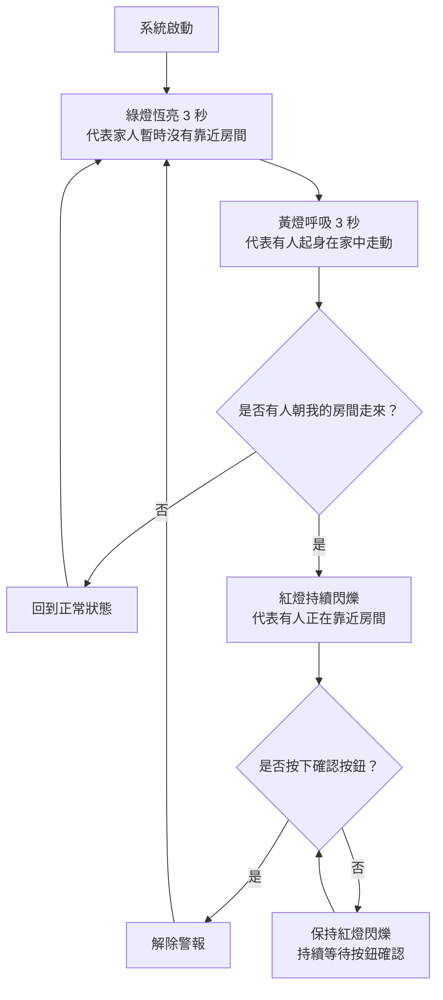

# STM32 LED 個人隱私預警系統

## 一、專題介紹與製作動機

在日常生活中，每個人都需要屬於自己的個人空間。當我待在房間休息、讀書或做自己的事情時，有時候會希望家人不要突然開門進來打擾，因此我希望能夠設計一套簡單的預警系統，提前提醒我是否有人正朝房間靠近。

本專題以 STM32 NUCLEO-G474RE 開發板為核心，透過紅、黃、綠三種 LED 燈號，模擬家人在家中的活動情況，讓使用者可以透過燈號變化，判斷是否需要提前做好準備。

由於本次專題主要目的是展示系統的運作概念，因此不會實際安裝人體感測器，而是透過程式的時間控制、隨機狀態切換及按鈕互動，模擬智慧預警系統的運作方式。

## 二、LED 燈號與情境對照

| LED 燈號 | 運作方式 | 模擬情境 |
|---|---|---|
| 🟢 綠燈 | 恆亮 3 秒 | 家人在客廳或自己的房間活動，沒有靠近我的房間 |
| 🟡 黃燈 | 呼吸 3 秒 | 有家人起身走動，例如上廁所或洗碗 |
| 🔴 紅燈 | 持續閃爍 | 有家人正朝我的房間走來，需要提前做好準備 |
| 🔘 按鈕 | 按下確認 | 表示自己已經準備好了，讓系統恢復正常 |

## 三、系統功能與運作流程

1. 系統啟動後，綠燈恆亮 3 秒，表示目前沒有家人靠近房間。
2. 綠燈熄滅後，黃燈開始呼吸 3 秒，模擬有人起身在家中走動。
3. 黃燈結束後，系統透過隨機判斷，決定進入正常狀態或緊急預警狀態。
4. 如果隨機結果為正常狀態，系統回到綠燈，重新執行整個流程。
5. 如果隨機結果為緊急預警狀態，紅燈開始持續閃爍，提醒使用者有人可能正朝房間走來。
6. 使用者的目標是在紅燈開始閃爍後 5 秒內按下確認按鈕，表示自己已經做好準備。
7. 如果沒有按下按鈕，紅燈會持續閃爍，不會自動解除警報。
8. 當使用者按下按鈕後，紅燈停止閃爍，系統重新從綠燈恆亮 3 秒開始執行。

## 四、使用技術

- **GPIO**：控制紅、黃、綠 LED 的亮滅。
- **RCC / PLL**：設定 STM32 系統時脈。
- **Timer / PWM**：控制黃燈呼吸效果及燈號變化。
- **EXTI**：偵測使用者按下確認按鈕。
- **UART**：可用於輸出系統目前的運作狀態，方便測試與除錯。

本專題重點在於結合課堂所學的 STM32 控制技術，利用簡單的 LED 與按鈕，呈現個人隱私預警系統的概念。

## 五、系統流程圖

## 六、功能與驗收條件

| 功能 | 預期結果 | 驗收方式 |
|---|---|---|
| 綠燈正常狀態 | 綠燈恆亮 3 秒 | 觀察亮燈時間 |
| 黃燈警戒狀態 | 黃燈逐漸變亮、變暗，持續 3 秒 | 觀察呼吸效果 |
| 隨機狀態切換 | 隨機回到綠燈或進入紅燈 | 重複測試多次 |
| 紅燈預警狀態 | 紅燈持續閃爍 | 觀察閃爍效果 |
| 按鈕確認 | 按下後立即重新進入綠燈狀態 | 實際按下按鈕 |
| 未按下按鈕 | 超過 5 秒仍持續紅燈閃爍 | 等待 5 秒以上確認 |

## 七、硬體設備與腳位規劃

### 使用設備

- STM32 NUCLEO-G474RE 開發板
- 紅色 LED × 1
- 黃色 LED × 1
- 綠色 LED × 1
- 按鈕 × 1
- 麵包板及杜邦線
- LED 限流電阻
- USB 傳輸線

### 腳位配置

| 元件 | STM32 腳位 | 功能 |
|---|---|---|
| 綠色 LED | 待確認 | 正常狀態指示 |
| 黃色 LED | 待確認 | PWM 呼吸效果 |
| 紅色 LED | 待確認 | 緊急預警閃爍 |
| 確認按鈕 | 待確認 | EXTI 按鈕中斷 |

