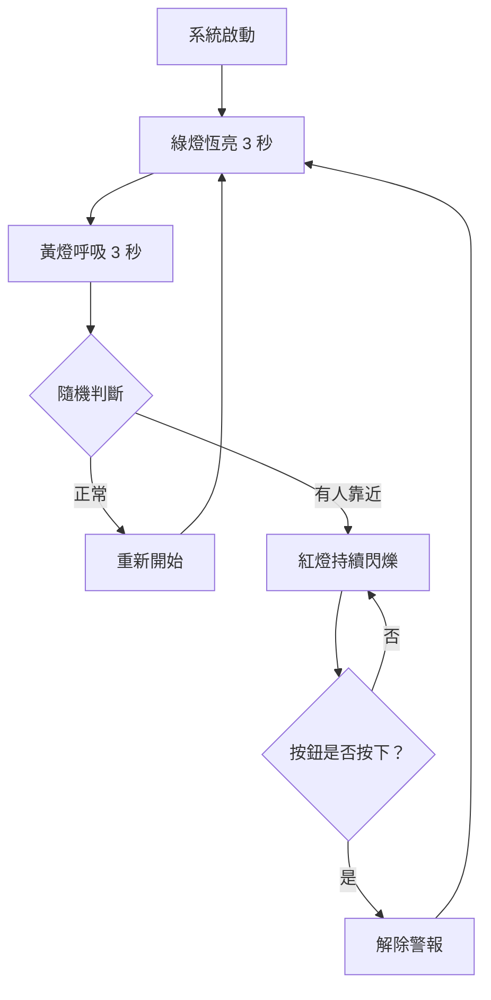

# STM32 LED 個人隱私預警系統

**STM32 LED Privacy Alert System**

本專題使用 STM32 NUCLEO-G474RE 開發板，透過三種 LED 燈號及按鈕互動，模擬個人房間的隱私預警系統。

---

<details>
<summary><strong>一、專題介紹與製作動機</strong></summary>

### 專題介紹

在日常生活中，每個人都需要屬於自己的個人空間。當我待在房間休息、讀書或做自己的事情時，有時候會希望家人不要突然開門進來打擾，因此我希望能夠設計一套簡單的預警系統，提前提醒我是否有人正朝房間靠近。

本專題以 STM32 NUCLEO-G474RE 開發板為核心，透過紅、黃、綠三種 LED 燈號，模擬家人在家中的活動情況，讓使用者可以透過燈號變化，判斷是否需要提前做好準備。

### 製作動機

由於我很重視個人隱私與獨立空間，因此希望透過這次微算機專題，將生活中遇到的問題結合課堂所學，設計出具有實際應用概念的系統。

本次專題不會實際安裝人體感測器，而是透過程式的時間控制、隨機狀態切換及按鈕互動，模擬智慧預警系統的運作方式。

</details>

<details>
<summary><strong>二、LED 燈號與情境對照</strong></summary>

本專題利用三種不同顏色的 LED，代表家人在家中的不同活動情況。

| LED 燈號 | 運作方式 | 模擬情境 |
|---|---|---|
| 🟢 綠燈 | 恆亮 3 秒 | 家人在客廳或自己的房間活動，沒有靠近我的房間 |
| 🟡 黃燈 | 呼吸 3 秒 | 有家人起身走動，例如上廁所或洗碗 |
| 🔴 紅燈 | 持續閃爍 | 有家人正朝我的房間走來，需要提前做好準備 |
| 🔘 按鈕 | 按下確認 | 表示自己已經準備好了，讓系統恢復正常 |

### 情境說明

**正常狀態（綠燈）**

家人正在客廳看電視、看書，或各自在房間活動，目前沒有需要特別注意的情況。

**警戒狀態（黃燈）**

家人開始在家中走動，例如起身上廁所、洗碗等，此時尚未確定是否有人會朝我的房間靠近。

**緊急預警狀態（紅燈）**

模擬偵測到有人正朝我的房間走來，系統透過紅燈閃爍提醒我做好準備。

</details>

<details>
<summary><strong>三、系統功能與運作流程</strong></summary>

### 系統運作流程

1. 系統啟動後，綠燈恆亮 3 秒，表示目前沒有家人靠近房間。

2. 綠燈熄滅後，黃燈開始呼吸 3 秒，模擬有人起身在家中走動。

3. 黃燈結束後，系統透過隨機判斷，決定進入正常狀態或緊急預警狀態。

4. 如果隨機結果為正常狀態，系統回到綠燈，重新執行整個流程。

5. 如果隨機結果為緊急預警狀態，紅燈開始持續閃爍，提醒使用者有人可能正朝房間走來。

6. 使用者的目標是在紅燈開始閃爍後 5 秒內按下確認按鈕，表示自己已經做好準備。

7. 如果沒有按下按鈕，紅燈會持續閃爍，不會自動解除警報。

8. 當使用者按下按鈕後，紅燈停止閃爍，系統重新從綠燈恆亮 3 秒開始執行。

### 特別說明

5 秒代表希望使用者能夠及時確認的目標時間。

如果超過 5 秒沒有按下按鈕，紅燈仍會繼續閃爍，直到使用者按下確認按鈕為止。

</details>

<details>
<summary><strong>四、使用技術</strong></summary>

本專題結合微算機課程所學的 STM32 控制技術。

| 使用技術 | 功能說明 |
|---|---|
| GPIO | 控制紅、黃、綠 LED 的亮滅 |
| RCC / PLL | 設定 STM32 系統時脈 |
| EXTI | 偵測使用者按下確認按鈕 |
| Timer / PWM | 控制黃燈呼吸效果及燈號變化 |
| UART | 輸出系統目前的運作狀態，方便測試與除錯 |
| HAL Library | 使用 STM32 HAL 函式控制硬體 |

### 開發方式

使用 STM32CubeMX 配置周邊功能，並透過 STM32CubeIDE 編寫 C 語言程式。

優先使用 HAL Library 控制周邊，並將自行撰寫的功能程式放在 USER CODE 區域。

</details>

<details>
<summary><strong>五、系統流程圖</strong></summary>

以下流程圖呈現個人隱私預警系統的運作方式。



### 流程說明

- 綠燈：正常狀態，維持 3 秒。
- 黃燈：警戒狀態，呼吸 3 秒。
- 隨機判斷：決定返回正常狀態或進入預警狀態。
- 紅燈：持續閃爍，直到使用者按下按鈕。
- 按鈕確認：解除預警，重新執行系統流程。

</details>

<details>
<summary><strong>六、功能與驗收條件</strong></summary>

| 功能 | 預期結果 | 驗收方式 |
|---|---|---|
| 綠燈正常狀態 | 綠燈恆亮 3 秒 | 觀察亮燈時間 |
| 黃燈警戒狀態 | 黃燈逐漸變亮、變暗，持續 3 秒 | 觀察呼吸效果 |
| 隨機狀態切換 | 隨機回到綠燈或進入紅燈 | 重複測試多次 |
| 紅燈預警狀態 | 紅燈持續閃爍 | 觀察閃爍效果 |
| 按鈕確認 | 按下後重新進入綠燈狀態 | 實際按下按鈕 |
| 未按下按鈕 | 超過 5 秒仍持續紅燈閃爍 | 等待 5 秒以上確認 |

### 預期成果

完成後，系統應能自動執行綠燈、黃燈與隨機狀態切換，並在紅燈預警狀態下等待使用者按鈕確認。

</details>

<details>
<summary><strong>七、硬體設備與腳位規劃</strong></summary>

### 使用設備

- STM32 NUCLEO-G474RE 開發板
- 紅色 LED × 1
- 黃色 LED × 1
- 綠色 LED × 1
- 按鈕 × 1
- 麵包板及杜邦線
- LED 限流電阻
- USB 傳輸線

### 腳位配置

| 元件 | STM32 腳位 | 功能 |
|---|---|---|
| 綠色 LED | 待確認 | 正常狀態指示 |
| 黃色 LED | 待確認 | PWM 呼吸效果 |
| 紅色 LED | 待確認 | 緊急預警閃爍 |
| 確認按鈕 | 待確認 | EXTI 按鈕中斷 |

> 腳位將依照 STM32CubeMX 的實際設定進行更新。

</details>

<details>
<summary><strong>八、專案目錄結構</strong></summary>

### 預計專案結構

```text
STM32-LED-Smart-System/
├── README.md
├── Core/
│   ├── Inc/
│   │   └── main.h
│   └── Src/
│       ├── main.c
│       └── stm32g4xx_it.c
├── Drivers/
└── Lab5.ioc
```

### 主要檔案說明

- `README.md`：專題介紹、系統流程及操作說明。
- `Core/Src/main.c`：LED 狀態控制、隨機切換及按鈕處理。
- `Core/Src/stm32g4xx_it.c`：中斷服務程式。
- `Core/Inc/main.h`：主要宣告及 GPIO 腳位定義。
- `Drivers/`：STM32 HAL 驅動程式。
- `Lab5.ioc`：STM32CubeMX 的硬體設定檔。

> 目前為預計的專案結構，實際檔案上傳後將依照 GitHub Repository 的內容更新。

</details>

<details>
<summary><strong>九、建置與執行方式</strong></summary>

### 開發環境

- 開發板：STM32 NUCLEO-G474RE
- 開發工具：STM32CubeIDE、STM32CubeMX
- 程式語言：C
- 函式庫：STM32 HAL Library

### 執行步驟

1. 使用 STM32CubeIDE 開啟專題專案。
2. 確認 GPIO、EXTI、Timer/PWM 等周邊設定。
3. 依照腳位配置連接 LED、限流電阻與按鈕。
4. 點擊 Build 編譯程式。
5. 透過 USB 與 ST-LINK 將程式燒錄至開發板。
6. 觀察綠燈、黃燈、紅燈的狀態切換。
7. 當紅燈閃爍時，按下按鈕測試警報解除功能。

### 預期執行結果

系統啟動後，會依序執行綠燈恆亮、黃燈呼吸及隨機狀態判斷。

若進入紅燈預警狀態，系統將持續閃爍紅燈，直到按下確認按鈕，才重新開始流程。

> 本章節為預計的建置與測試流程，實作完成後將依實際操作結果更新。

</details>
